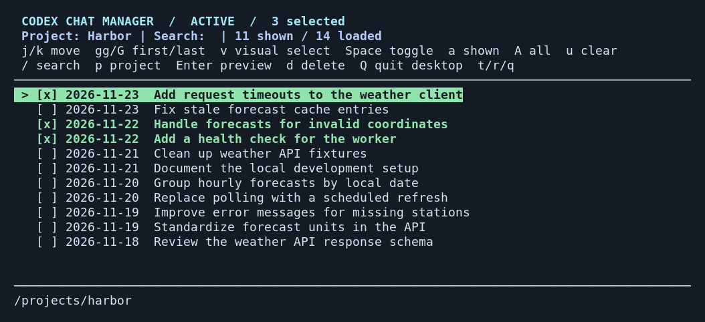
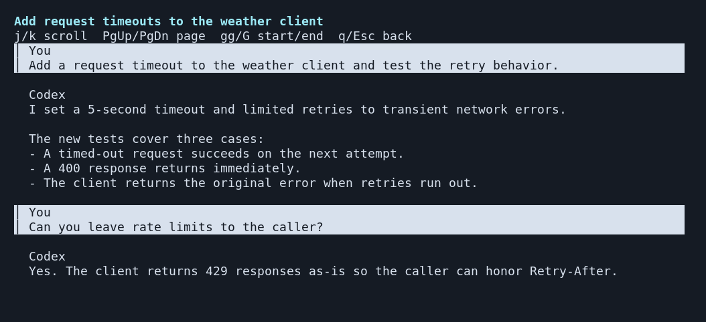

# Codex Chat Manager

A Linux terminal app for managing local Codex chats.

I like a clean Codex sidebar. I couldn't find a way to delete a bunch of chats at once in the desktop app, so I built this.

Build with `make` and launch with `./chat-manager`. Requires a C compiler, `make`, `pkg-config`, development files for ncursesw, json-c, SQLite, and libzstd, and the Codex CLI on `PATH`.

## Features

- Browse active and archived chats.
- Search by title or folder and filter by project.
- Preview chat messages in the terminal.
- Select chats individually, by range, or in bulk.
- Permanently delete selected chats, including attached side chats and spawned child chats.
- Back up desktop sidebar metadata before cleanup.
- Use a custom Codex data directory via `CODEX_HOME`.

## Keyboard shortcuts

| Key | Action |
| --- | --- |
| `j` / `k` or ↑ / ↓ | Move or scroll |
| `gg` / `G` | Jump to the start or end |
| Page Down / Page Up or Ctrl+D / Ctrl+U | Move one page |
| `/` | Search by title or folder. Enter an empty search to clear it |
| `p` | Filter by project |
| Enter | Preview the highlighted chat. Press `q` or Esc to return |
| Space | Toggle the highlighted chat |
| `v` | Start a range. Press `v`, Space, or Enter to select it, or Esc to cancel |
| `a` / `A` | Toggle all visible chats or select all loaded chats |
| `u` | Clear the selection |
| `t` / `r` | Switch between active and archived chats or refresh. Both clear the selection |
| `d` | Delete selected chats, including hidden selections. Review any blocking forks and confirm with `DELETE` |
| `Q` | Quit the ChatGPT desktop app. Finds `chatgpt` on `PATH` or uses the absolute binary path set in `CODEX_DESKTOP_EXE` |
| `q` | Quit the manager |

## Screenshots

